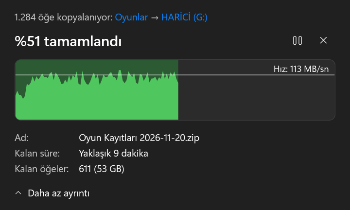
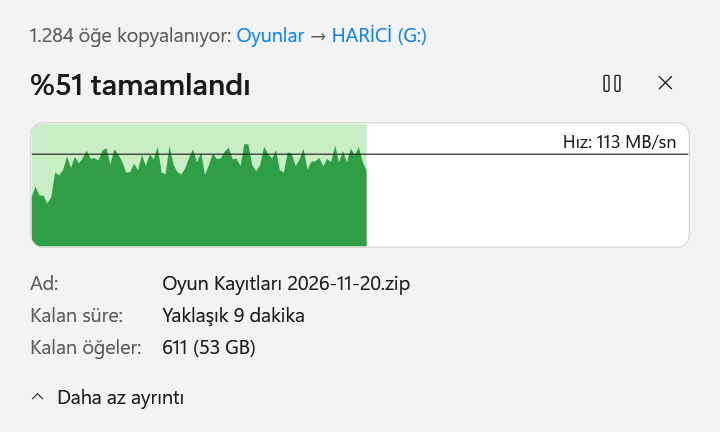

# RoboKopya

Windows'un sağ tık menüsüne "Robocopy ile kopyala" ve "Robocopy ile yapıştır" seçeneklerini ekleyen küçük bir araç. Büyük klasörleri harici diske taşırken Gezgin'in kopyalaması bazen yavaş kalıyor, takılınca da ne olduğunu söylemiyor. Robocopy bu işte çok daha sağlam ama konsol penceresine bakmak keyifli değil. RoboKopya ikisinin arasında duruyor: kopyalamayı robocopy yapıyor, ilerlemeyi ise Windows'un kendi kopyalama penceresine benzeyen bir pencere gösteriyor.





Görüntüler uygulamanın örnek verilerle çizdiği pencereden alındı.

## Ne yapar

- Dosya ve klasörlerde "Robocopy ile kopyala", klasörlerde, klasörün boş alanında ve sürücülerde "Robocopy ile yapıştır" seçeneği çıkar.
- Birden çok öğeyi aynı anda seçip kopyalayabilirsin; seçim birkaç saniye içinde tek listede toplanır.
- Yapıştırınca açılan pencerede yüzde, anlık hız (MB/sn), hız grafiği, kopyalanan dosyanın adı, kalan süre ve kalan öğe sayısı görünür.
- Duraklatma ve iptal düğmeleri var. İptal etmeden önce onay sorar.
- Windows'un koyu ya da açık temasını izler.
- Başarıyla biterse pencere 3 saniye sonra kendiliğinden kapanır. Hata olursa açık kalır ve hangi öğede ne olduğunu gösterir.

Hiçbir şey silinmez. `/MIR` ya da `/MOV` gibi bayraklar kullanılmıyor, yalnızca kopyalanıyor.

## Robocopy ayarları

| Tür | Bayraklar |
| --- | --- |
| Klasör | `/E /COPY:DAT /DCOPY:DAT /MT:16 /R:1 /W:1 /NP /NDL /XJ` |
| Tek dosya | `/COPY:DAT /J /R:1 /W:1 /NDL` |

Klasörler 16 iş parçacığıyla kopyalanır. Tek dosyalarda `/J` ile önbellek atlanır, büyük dosyalarda bu fark ediliyor. Bağlantı noktaları (`/XJ`) atlanır, böylece bir klasörün kendi içine dönen bağlantıları sonsuz döngüye sokmaz. Bir klasörü kendi içine kopyalamaya çalışırsan o öğe atlanır.

## Kurulum

Gerekenler: Windows 10/11, .NET 8 Masaüstü Çalışma Zamanı. Derlemek için .NET 8 SDK.

```powershell
dotnet publish src\RoboKopya -c Release -o out
powershell -ExecutionPolicy Bypass -File .\kur.ps1
```

`kur.ps1` dosyaları `%LOCALAPPDATA%\RoboKopya` altına kopyalar ve sağ tık girdilerini yalnızca `HKCU` altına yazar, yönetici izni istemez. Kaldırmak için:

```powershell
powershell -ExecutionPolicy Bypass -File .\kaldir.ps1
```

Windows 11'de seçenekler "Daha fazla seçenek göster" altında durur. Shift ile sağ tıklarsan doğrudan görünür.

## Kullanım

1. Kopyalamak istediğin dosya ya da klasörlere sağ tıkla, "Robocopy ile kopyala"yı seç.
2. Hedef klasöre ya da sürücüye sağ tıkla, "Robocopy ile yapıştır"ı seç.
3. Pencere açılır, ilerlemeyi oradan izlersin.

Uygulamanın komut satırında iki yardımcı modu da var:

- `RoboKopya.exe --test [rapor.txt]` pencere açmadan geçici bir klasörde küçük bir kopyalama yapar ve sonucu dosyaya yazar.
- `RoboKopya.exe --ekran-goruntusu <çıktı.png> [acik|koyu]` pencereyi örnek verilerle çizip PNG olarak kaydeder. README'deki görüntüler böyle üretildi.

## Yapı

```
src/RoboKopya/            WPF uygulaması
  Program.cs              giriş noktası, seçimi okuma, yardımcı modlar
  Motor.cs                robocopy süreçlerini çalıştırma, duraklatma, iptal
  AnaPencere.xaml(.cs)    ilerleme penceresi ve hız grafiği
  Cekirdek/Planlayici.cs  hangi kaynağın nereye, hangi bayraklarla gideceği
  Cekirdek/Cikti.cs       robocopy çıktısından ilerleme ve hata ayıklama
tests/RoboKopya.Testler/  Cekirdek için xUnit testleri
kabuk/                    sağ tık betikleri
  kopyala.vbs             PowerShell'i pencere göstermeden başlatır
  kopyala.ps1             seçilen yolu kilitli şekilde secim.txt'ye ekler
  yapistir.ps1            pencereli sürümden önceki konsol yapıştırıcısı (yedek)
kur.ps1 / kaldir.ps1      kurulum ve kaldırma
```

Testleri çalıştırmak için:

```powershell
dotnet test tests\RoboKopya.Testler
```

## Lisans

MIT. Ayrıntı için `LICENSE` dosyasına bak.
